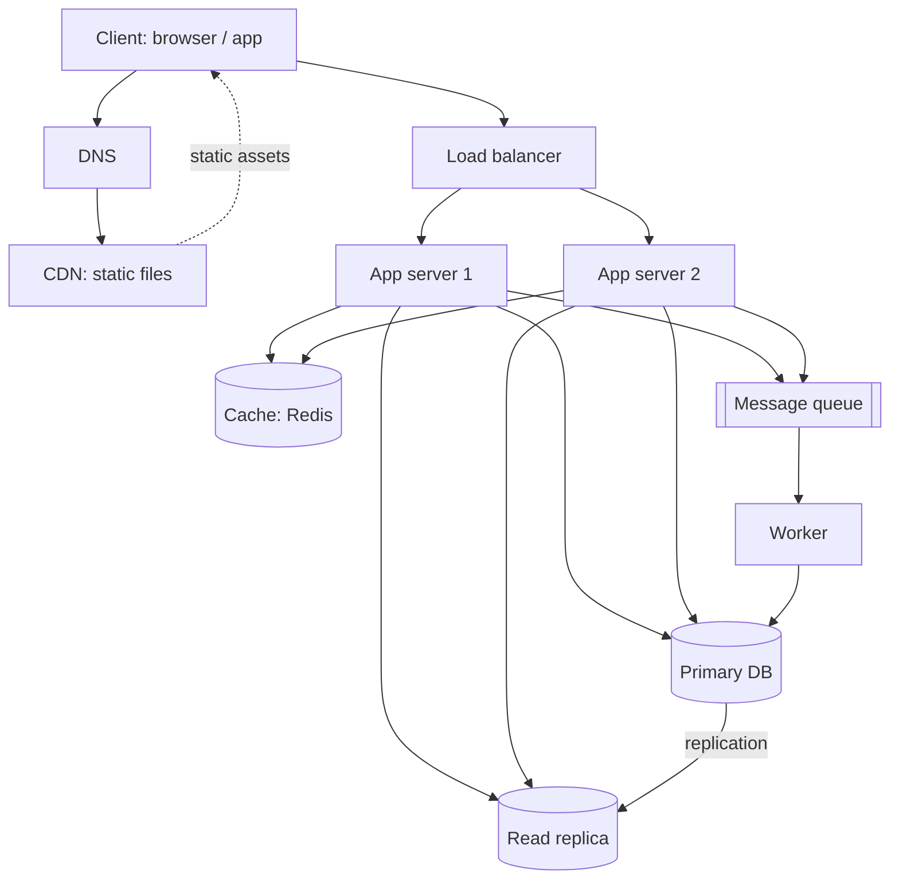

# QuickNotes Architecture

## Requirements

**Functional**

- Register, sign in and sign out.
- Create, read, update and delete notes.
- Tag notes and filter by tag.
- List notes with pagination.

**Non-functional**

- Availability 99.9%, with no single point of failure.
- Latency: reads under 200 ms at p95.
- Durability: no note lost once saved.
- Scalability: 1 million users, able to grow 10x.
- Security: HTTPS everywhere, hashed passwords, per-user data isolation.

## Load estimate (1 million users)

Assumptions: 20% daily active (200,000 users), each reading notes 50 times/day and creating 10 notes/day; average note 1 KB.

| Metric              | Calculation     | Result                         |
| ------------------- | --------------- | ------------------------------ |
| Reads/day           | 200,000 × 50    | 10,000,000                     |
| Reads/second (avg)  | 10M / 86,400    | ≈ 116 (peak ×3 ≈ 350)          |
| Writes/day          | 200,000 × 10    | 2,000,000                      |
| Writes/second (avg) | 2M / 86,400     | ≈ 23 (peak ×3 ≈ 70)            |
| Storage/year        | 2M × 365 × 1 KB | ≈ 730 GB (≈ 1 TB with indexes) |

Reads outnumber writes about 5:1, so caching and read replicas pay off.

## Architecture diagram

## Components (one problem each)

- **Client:** gives users the interface and sends API requests.
- **DNS:** turns `quicknotes.example` into the address of the CDN or load balancer so users never need an IP.
- **CDN:** serves HTML, CSS and JS from servers near the user, cutting latency and load on our servers.
- **Load balancer:** spreads requests across app servers and removes unhealthy ones, so no single server is overloaded or fatal.
- **App servers (2+):** run the stateless API logic and can be added or removed to scale.
- **Cache (Redis):** keeps hot reads (recent notes lists) in memory so the database is hit less often.
- **Primary database:** the single source of truth that handles all writes safely.
- **Read replica:** serves read queries and holds a copy for failover, relieving the primary.
- **Queue:** absorbs spikes and lets slow tasks (search indexing, emails, tag counts) happen outside the request.
- **Worker:** consumes queue jobs in the background and updates the database.

## Request flows

**GET /notes**

1. Client sends the request with its token; DNS resolves the host.
2. The load balancer picks a healthy app server.
3. The app validates the token and builds a cache key such as `notes:user:1:page:1`.
4. Cache hit: return the cached JSON (200).
5. Cache miss: query the read replica, store the result in the cache with a short TTL (about 60 s), then return 200.

**POST /notes**

1. Client sends JSON with its token through the load balancer.
2. The app server validates the token and body (title required, max 100 characters); otherwise it returns 400.
3. The app writes the note to the primary database.
4. It invalidates the user's list cache keys.
5. It publishes a job to the queue (e.g. "index note 101") and returns 201 Created with the note.
6. A worker consumes the job later and does the background work without delaying the user.

## Trade-offs

1. **Cache vs freshness:** a 60 s TTL plus invalidation on write makes reads fast, but a user could briefly see stale data after another device edits a note.
2. **Read replica and eventual consistency:** replicas lag the primary by milliseconds, so a read right after a write may miss it. Mitigation: read the user's own latest write from the primary or cache.
3. **Queue vs simplicity:** a queue makes writes fast and resilient to spikes but adds infrastructure and means background work is eventually, not instantly, done.
4. **SQL vs NoSQL:** SQL gives consistency but scales writes vertically; fine at about 70 writes/s peak.

## Avoiding single points of failure

- DNS and CDN are managed multi-location services.
- Run two or more load balancers (active/passive with a floating IP or a managed LB).
- App servers are stateless, at least two, in different availability zones.
- Redis runs with a replica and automatic failover; if it fails, the app falls back to the database.
- The primary database has a replica that can be promoted automatically, plus daily backups.
- The queue is clustered/replicated and workers can run on several machines.
